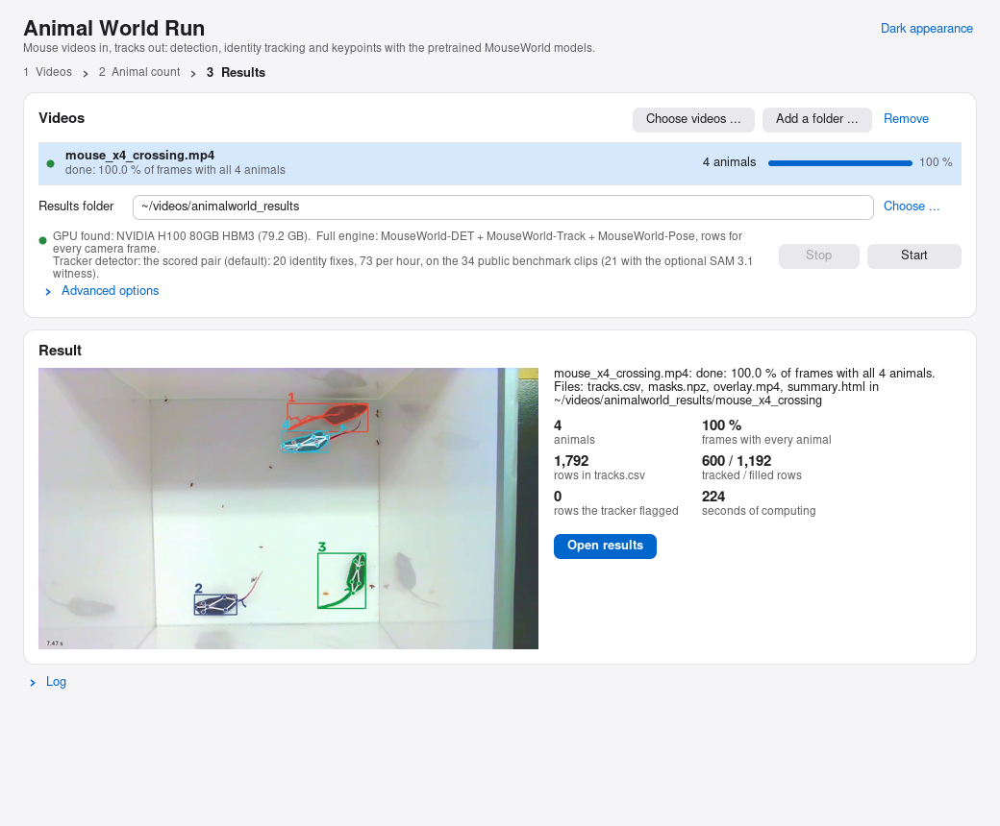
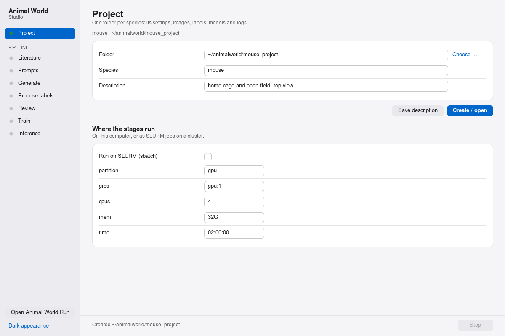
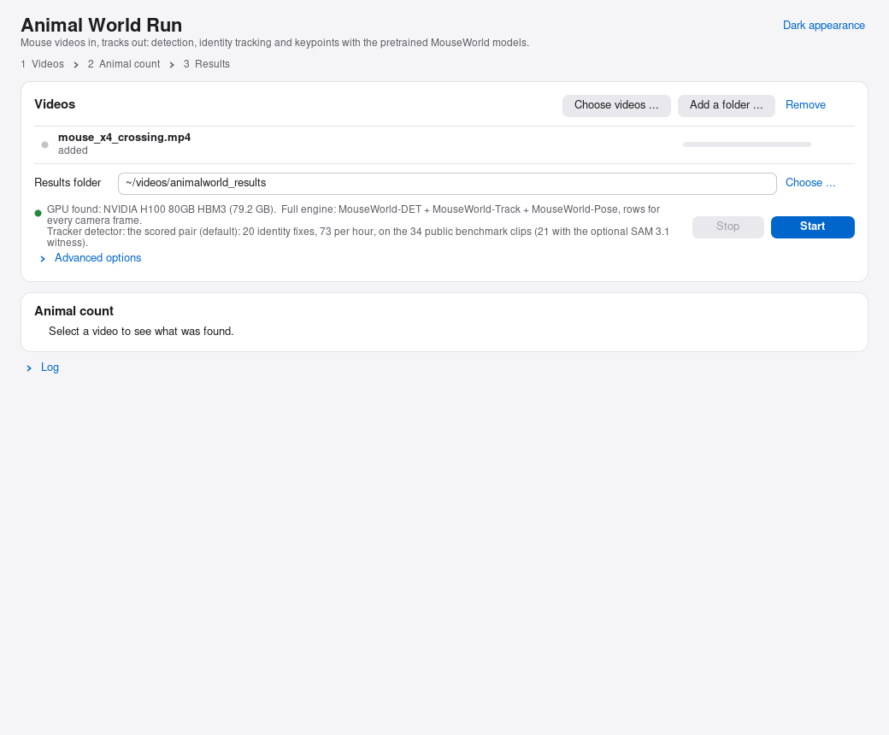

# animalworld

Species name in, deployable detection / pose / tracking models out.

You give a species and a short description (`mouse`, "laboratory, home cage and open field"). The
pipeline searches the literature, extracts a taxonomy (appearance, group size, behaviour, lighting,
camera, arena), writes diversified prompts, generates images or clips, lets proposal models label
them, puts a human in the loop to accept or correct the labels, builds a COCO + YOLO dataset, trains
models once enough images are accepted, and runs the exported weights on real recordings
(boxes, keypoints, identities).

> Status: 0.2.0, alpha, **not published** (no PyPI package, no public repository, no weight download site).
> Read [STATUS.md](STATUS.md) first: it lists exactly what was executed, what was only dry-run, and what is untested.

## Try it in two commands

```bash
bash install.sh --gpu                       # or: bash install.sh   (no NVIDIA GPU: the CPU engine)
~/animalworld-env/bin/animalworld demo      # fetches six short demo clips, checks them, opens Animal World Run with them
```

Press **Start**, confirm the animal counts, and each clip gets `tracks.csv` (identity, box and keypoints for every camera
frame), `masks.npz`, `overlay.mp4` and a one-page summary. `animalworld demo --headless --out DIR` does the same without a
window. Nothing gated is needed: SAM 3.1 is an option (`--sam3`), not a requirement.



The two downloads (weights, demo clips) point at the releases `weights-v1` and `demo-v1` of
https://github.com/GuangWei-Zhang-25/AnimalWorld. Until those releases are uploaded, set `ANIMALWORLD_WEIGHTS_URL` and `ANIMALWORLD_DEMO_URL` (an address
or a local folder), or see [INSTALL.md](INSTALL.md).

## Quick start

```bash
bash install.sh                 # creates ~/animalworld-env and installs the local wheel with the [run] extra
~/animalworld-env/bin/animalworld studio    # Animal World Studio: the whole pipeline in one window
~/animalworld-env/bin/animalworld run       # Animal World Run: pick mouse videos, press Start (same as: mouseworld)
```

`bash install.sh --gpu` adds the full engine for an NVIDIA GPU. Repository: https://github.com/GuangWei-Zhang-25/AnimalWorld. The public one-liner
(`pip install "animalworld[run]"`, or `pip install "animalworld[run] @ git+https://github.com/GuangWei-Zhang-25/AnimalWorld.git"` from the repository) needs the
upload, which has not happened yet. The model weights and the demo clips are separate downloads (`weights_release/`,
`demo_release/`; prepared, not uploaded); [INSTALL.md](INSTALL.md) says which line works today, where the files come
from and how to upload them. What is still open before a public release: [RELEASE_CHECKLIST.md](RELEASE_CHECKLIST.md).

Both windows are plain Python (tkinter / ttk): no browser, no server, no extra GUI package. One shared style
(`animalworld/ui.py`): a quiet neutral window with white rounded cards, one accent colour, the system's UI font, light
and dark (follows the system where it can be found out; a switch in the window; `ANIMALWORLD_THEME=light|dark`), and a
scale for dense displays (`ANIMALWORLD_UI_SCALE=2`). They need a display; without one, every step is a command
(`animalworld zeroshot VIDEOS... --out FOLDER`, `animalworld pipeline PROJECT`, the stage commands).

**Animal World Studio** (`animalworld studio`): a sidebar of stages, each with a status dot; a stage is one page with
a status line, a form (label left, control right), one accented button and a log that can be opened. Species and description, literature, target number of images, generation (Qwen-Image 2.1 open
weights as the worked example, or an API with endpoint / model / key), proposal models, human-in-the-loop review in
a canvas annotator, the image-count gate before training, and inference + tracking on your videos.
See [docs/STUDIO.md](docs/STUDIO.md).



**Animal World Run** (`animalworld run`): the zero-shot app, three steps on one screen: choose videos (or a folder),
confirm the animal count, read the result card. Engine, tracker detector and SAM 3.1 sit under "Advanced options".
Press Start. It checks the computer, proposes the number of animals with a picture of what it found, waits for you to
confirm or correct it, then writes per video `tracks.csv`, `masks.npz`, `overlay.mp4`, `contact_sheet.jpg` and a
one-page `summary.html`.

* **Engine on an NVIDIA GPU:** MouseWorld-DET, MouseWorld-Track (the frozen v7j rule set fed by the scored pair of
  detector checkpoints, with SAM 2.1 witnesses) and MouseWorld-Pose.
* **Every camera frame:** the identity tracker runs at about 10 frames per second, the rate it was scored at. The
  frames in between are filled from MouseWorld-DET's detection on that frame, attached to the tracked identities; the
  column `source` says `tracked`, `filled` or `interpolated` for every row. `--analysis-frames-only` writes the tracked
  frames only.
* **Small animals in a wide frame: automatic zoom.** The app looks at the whole clip first. If the animals are small in
  the frame, or the frame is two cameras side by side, it analyses each region where animals are active zoomed in and
  maps everything back to full-frame pixels; unused parts of the frame are left out. `--zoom off` switches it off,
  `--zoom REGIONFILE` takes your own regions. When the animals are large enough nothing changes. The animal count you
  confirm is split over the regions and always adds up to your number.
* **Stable boxes and outlines.** Box, outline and position of every output frame come from one source: a final SAM 2.1
  propagation at the camera rate, anchored on the identities the tracker resolved (`--fill detector` gives the earlier,
  faster per-frame detector boxes, which flicker). `overlay_masks.mp4` shows the segmentation alone.
* **SAM 3.1 is optional** (`--sam3`, or the checkbox). Its weights are gated by Meta's licence and 3.5 GB, so the
  default does not use it. Measured on the 34 public benchmark clips (16.5 min): 20 identity fixes without it, 21 with.
* **Other detector settings** (`--tracker-detector strongest`, `strongest_two_seeds`, `strongest_recut`) score worse
  on that benchmark (42, 39 and 25 fixes against 21); see INSTALL.md.
* **Without a usable GPU** it falls back to MouseWorld-DET-Lite with a simple tracker and says plainly that tracking
  quality is lower.



## Install details

```bash
pip install "dist/animalworld-0.2.0-py3-none-any.whl[run]"   # works today, from this folder
pip install "animalworld[run]"                                # after the PyPI upload
pip install "animalworld[run] @ git+https://github.com/GuangWei-Zhang-25/AnimalWorld.git"   # after the repository is pushed
```

| extra | adds | needed for |
|---|---|---|
| *(core)* | numpy, pillow, pyyaml, requests | Studio with mock / offline backends, the annotator, COCO/YOLO/DLC export, blob detector, default tracker |
| `run` | opencv, onnxruntime, imageio-ffmpeg | Animal World Run on any computer (CPU engine) |
| `run-gpu` | torch, rfdetr, ultralytics, sam2, scipy (+ SAM 3 from GitHub) | the full zero-shot engine on an NVIDIA GPU |
| `generate` | torch, diffusers, transformers, opencv | `qwen_image`, `wan_video` generators, `sam` proposer |
| `annotate` | opencv, sleap-io, pandas, tables | video frames, `.slp` files, DeepLabCut `.h5` |
| `train` | ultralytics, rfdetr | `yolo`, `rfdetr` trainers and native predictors |
| `deploy` | onnxruntime, opencv | `onnx` predictor, video input |
| `llm` | anthropic | optional LLM slot expansion |

## Five-minute demo (CPU, no network, no model weights)

```bash
animalworld init demo --species mouse --describe "laboratory, home cage and open field"
animalworld pipeline demo --dry-run                   # prints the plan of every stage, runs nothing
animalworld pipeline demo --auto-accept --train-dry-run  # runs every stage with the mock/offline backends
animalworld status demo
animalworld review demo --gui                       # the annotator window (tkinter)
animalworld demo-recording demo_rec --frames 40 --n 3
animalworld predict demo --source demo_rec --backend blob
animalworld track demo
```

`examples/mouse/README.md` walks through the same project with the real backends.

## The stages (Figure 1a)

| Figure 1a box | command | backends |
|---|---|---|
| Prompt engineering: literature search | `literature` | `offline`, `europepmc`, `pubmed` |
| Prompt engineering: keywords / taxonomy | `taxonomy` | regex rules in `slots.yaml` |
| Prompt engineering: diversified prompts | `prompts` | `template` (deterministic), `llm` (optional) |
| Generation: image / edit and video models | `generate` | `mock`, `qwen_image`, `wan_video`, `http_api` |
| Annotation: proposal models | `propose` | `mock`, `sam`, `yolo`, `pose` |
| Annotation: human-in-the-loop, refine | `review --gui`, `import-labels`, `export-labels` | bundled desktop annotator; COCO, YOLO, DeepLabCut, SLEAP |
| Species datasets (boxes, masks, keypoints) | `dataset` | COCO + YOLO (+ top-down pose crops) |
| Model training | `train` | `yolo`, `rfdetr`, `sleap_dlc` |
| Deployment | `export`, `predict`, `track`; `zeroshot` | `onnx`, `ultralytics`, `rfdetr`, `blob`; trackers `iou`, `rules`; `zeroshot` = pretrained MouseWorld-DET + MouseWorld-Track + MouseWorld-Pose |

Every stage reads and writes the project folder, can be re-run, and accepts `--dry-run`.
`animalworld pipeline PROJECT` runs them in order; `animalworld status PROJECT` shows counts per stage.

### Human in the loop and the training gate

`propose` never accepts anything. Labels enter the dataset only through `review`: in the
annotator window (accept **A**, reject **R**, draw a box **B**, an outline **P**, keypoints **K**, move or
resize anything), by importing labels corrected in SLEAP or DeepLabCut, or, if you choose, with
`--auto` (accept every proposal that passes the automatic gates).

Training is gated: `train.min_accepted_images` (default 200). Below it, `train` tells you how many
more accepted images are needed. `train --force` trains a small model anyway, which you can use as
the proposer for the next round (`propose --backend yolo`): that is the refine loop.

## A new species needs only YAML

`animalworld init birds --species zebra_finch --describe "..."` writes a generic `slots.yaml`; edit
the vocabulary (appearance, arenas, behaviours, keypoints, literature keywords) and run. Nothing in
the Python core is mouse specific. `examples/pig/` is a complete second species in two YAML files.

## Credentials (optional commercial backends)

Tokens never go into the project folder. Store them with `animalworld credentials set NAME` (written
to `~/.config/animalworld/credentials.toml`, mode 600) or export `ANIMALWORLD_NAME`. Configs refer
to a token by name (`token_credential: NAME`). See [docs/CREDENTIALS.md](docs/CREDENTIALS.md).

## Writing a backend

Each backend is one small class; register it through an entry point. See
[docs/BACKENDS.md](docs/BACKENDS.md). Architecture: [docs/ARCHITECTURE.md](docs/ARCHITECTURE.md).
Where the code came from: [docs/PROVENANCE.md](docs/PROVENANCE.md).

## Licence

**AGPL-3.0-or-later.** Reason: the default trainer and the native predictor call Ultralytics, which
is AGPL-3.0, and parts of the ONNX post-processing and the default tracker follow the lab's own
AGPL-3.0 application. Shipping the whole package under the same licence is the simple, safe choice.

This is a decision you may want to revisit: the core (literature, prompts, generation adapters,
annotator, formats) has no AGPL dependency and could be released under a permissive licence, with
the Ultralytics-based trainer/predictor in a separate AGPL plugin package. Generated images, model
weights of third-party generators, and commercial API outputs carry their own terms; check them
before training on or redistributing such data.

## Tests

```bash
pip install "dist/animalworld-0.2.0-py3-none-any.whl[run]" pytest && pytest
```

The window tests need a display and skip themselves without one (on a headless Linux machine: Xvfb).
